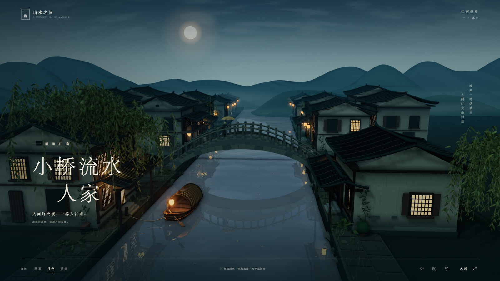

# 无尽江南 · 漫游与拾光

走进小桥、流水与人家之间，沿着河岸散步，乘乌篷船穿过石桥，在不断展开的江南水乡里寻找风物，写下自己的游记。

**[开始漫游](https://gaiiagherdev.github.io/jiangnan-water-town/play/)** · [欣赏原版画卷](https://gaiiagherdev.github.io/jiangnan-water-town/)

## 自由探索与收集

- 程序化生成的连续世界：河流、石桥、村落、竹林与垂柳随行程展开，离开的区域会释放，重访时按同一旅程种子还原。
- 第三人称步行与乘舟，可沿岸上下船；小地图帮助寻找桥梁、村落与风物。
- 收集六类风物，解锁诗句游记，完成探访村落、集齐风物和远行等阶段目标。
- 昼夜流转，也可固定为薄暮、月色或晨雾；支持画质选择、环境音和画面保存。
- 旅程名称决定世界。同名旅程会继续本地进度；位置、风物和游记自动保存在当前浏览器中。

这是面向自由探索的单人浏览器游戏。无需账号，存档保存在本机，清除浏览器网站数据会清除进度。

## 操作

| 操作 | 键鼠 | 触屏 |
| --- | --- | --- |
| 移动 | WASD / 方向键 | 左侧摇杆 |
| 奔跑 | 按住 Shift | 奔跑按钮 |
| 环顾 | 拖动画面 | 右侧滑动 |
| 镜头远近 | 滚轮 | — |
| 拾取 / 上下船 | E / 交互按钮 | 交互按钮 |
| 游记 | J / 游记按钮 | 游记按钮 |
| 暂停 | Esc / 菜单按钮 | 菜单按钮 |
| 重置视角 | R | — |

靠近金色风物即可拾取。靠近河岸时，可通过交互按钮登船或上岸。

## 原版画卷

首页保留「烟雨江南 · 小桥流水人家」观景作品：拖动观景、点击水面泛起涟漪、切换光景，并可开启溪水环境音、保存画面或隐藏界面。点击右上角「漫游江南」进入游戏。

以下为原版画卷预览，展示游戏延续的水乡视觉风格：



## 实现

Three.js r170 / WebGL 2，使用程序化几何与 Canvas 纹理构建黛瓦白墙、拱桥、乌篷船和植被。游戏通过分块生成与回收控制场景规模，以浮动原点保持远行精度；风物和地形均可由旅程种子复现。

运行时资源随站点一起构建，无需外部 CDN，也不含统计追踪。游戏需要支持 WebGL 2 的现代浏览器。

## 本地开发

```sh
npm ci
npm test
npm run build
npm run preview
```

打开 `http://localhost:8765/play/` 开始游戏，或访问 `http://localhost:8765/` 欣赏原版画卷。

- `src/game/`：游戏界面、操作、程序化世界和收集系统。
- `src/`：原版画卷及共用的 Three.js 依赖。
- `tests/`：世界生成、坐标、通行和收集物可达性测试。
- `scripts/build.mjs`：分别构建 `dist/index.html` 与 `dist/play/index.html`，将各自的脚本和样式内联。

`main` 分支每次推送都会通过 GitHub Actions 安装依赖、运行测试、构建并发布到 GitHub Pages。

Three.js 使用 MIT License，见 [第三方许可证](src/vendor/LICENSE-three.txt)。
